# GUGUOVA 游戏空间

一个离线的 Windows 游戏启动器。把本机的游戏收进一个界面，选一个，按下去就进游戏；
玩多久、什么时候玩的，它自己记账。不登录、不联网、不上传。

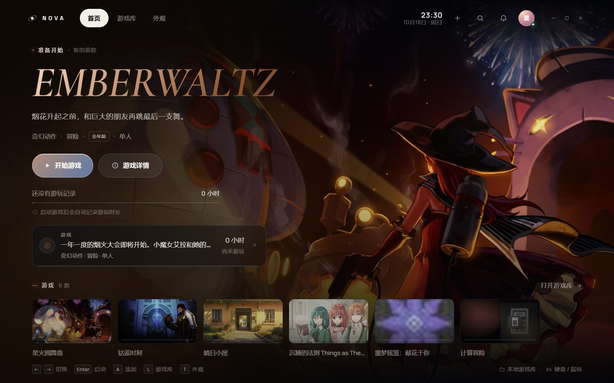

截图里的游戏都是虚构的示例条目，封面是按版式画的，不是任何真实游戏的画面。

---

## 下载与安装

发行包有两个版本，解压即用，不用安装。内置引擎是**轻量版**（Lanczos / FSR / FSRCNNX / CAS / Sharpen），去掉 Anime4K / CRT / CuNNy 等大型效果以降低启动扫描与占用：

| 包 | 适合谁 | 里面有什么 |
|---|---|---|
| `GUGUOVA-1.12.0-legacy-single.zip` | 大多数人 | exe + 轻量缩放引擎，界面和 14 套主题封在 exe 里，约 8.9 MB |
| `GUGUOVA-1.12.0-legacy-full.zip` | 想改主题的人 | exe + 轻量缩放引擎 + `src/` + `themes/`，约 12.2 MB |

步骤：

1. 解压到一个固定目录，例如 `D:\GUGUOVA`。不要放在下载文件夹里，之后清下载会一起删掉。
2. 双击 `GUGUOVA.exe`；如果系统提示缺少运行库，先双击 `launch.cmd`，它会告诉你缺什么。
3. 第一次打开，按 `A` 或点右上角的 `+`，把游戏加进来。

系统要求：

- Windows 10 / 11：直接能用。系统自带的 WebView2 就够。
- Windows 7 SP1 / 8.1：需要 .NET Framework 4.8 和 WebView2 109。发行包里带了 `WebView2Runtime/` 的说明。
- 不需要装 .NET SDK，也不需要联网。

---

## 加游戏

**方式一：扫本机（最快）**
按 `A`，选「浏览本机游戏」。它会读 Steam 库、开始菜单快捷方式，以及带 `nova-game.json` 清单的游戏。
勾选之后点「导入所选」，封面和主视觉会自动生成。

**方式二：手动指一个 exe**
按 `A` → 手动添加 → 选 exe、填名字。封面可以留空，程序会拿 exe 图标合成一张。

**方式三：给游戏做一份清单**
在游戏根目录放一个 `nova-game.json`，选中它的 exe 时会自动读出来：

```json
{
  "schema": 1,
  "name": "Lumen Vale",
  "zh": "流明谷",
  "exe": "bin/game.exe",
  "genre": "叙事·解谜",
  "ageRating": "12+",
  "tagline": "在会发光的山谷里，找回一段被折叠的时间。",
  "hero": "art/hero.jpg"
}
```

字段表在 [docs/INTEGRATION.md](docs/INTEGRATION.md)。

---

## 它能做什么

- **真启动**：调用游戏自己的 exe，或者交给 Steam 客户端启动。不是模拟进度条。
- **启动即入戏**：游戏窗口出现后自动置前，启动器同时最小化；退出游戏后回到原来的窗口。
- **全屏缩放（可选）**：首页和详情页都有「全屏缩放」开关，只有你打开它，启动器才会拉起内置 Magpie 轻量版（游戏退出后自动关闭）；没条件时用内置无边框铺满。沉浸式全屏下默认勾选。
- **Steam 提权修复**：检测 `steam.exe` 的「以管理员身份运行」标记，一键移除并重启客户端，之后启动游戏不再弹 UAC。
- **快捷键与引擎设置**：全屏缩放快捷键可在设置里录制；「引擎设置…」可改算法、捕获方式、光标缩放、帧率和 3D 模式。
- **真计时**：从进程出现到退出，记进本机库。异常退出也会留一条记录。
- **记住每次游玩**：开始时间、结束时间、时长，可以在设置里导出成 CSV。
- **封面与配色**：Steam 游戏直接取客户端缓存里的原图（1920 宽，不裁不放大）；
  自己的图会裁成 16:9；不给就用 exe 图标生成。界面主色从封面里取。
- **直接取景**：外观预览下方「编辑取景」，用方向条/拖动平移主视觉、缩放、复位，每款游戏单独记住。
- **Steam 库扫描**：读 `appmanifest_*.acf`，支持多个库盘，优先用 Steam 缓存里的封面。
- **Steam 启动接管**：对需要客户端的游戏，直接用 `steam.exe -applaunch` 交给客户端，避开「Steam 未运行 / 未登录」的报错。
- **手柄**：Xbox 和 PlayStation 手柄都能用，底部会显示当前手柄的按键提示。
- **全屏**：按 `F` 无边框铺满屏幕，`Esc` 退出。
- **睡眠模式**：变成一个大时钟，按任意键回来。
- **托盘常驻**：关窗口时可以缩到托盘，游戏还在玩就继续计时。
- **开机自启**：设置里可以勾选，登录 Windows 后在后台打开（写用户级 Run 项，不需要管理员）；
  下面紧跟「开机后无边框全屏启动」，勾上就开机即沉浸式全屏。
- **自己的界面**：确认框、右键菜单、选文件都是程序内的界面，不弹系统窗口。
- **离线数据包**：导出 `.nova-pack`，复制到另一台电脑导入，游戏库、封面、记录一起过去。
- **每天自动备份**：保留最近 5 份，放在数据目录的 `backups\`。

---

## 全屏缩放引擎

启动器自带 Magpie 0.12.1 **轻量版**（未修改的官方发行版，GPLv3，**独立进程**），解压即用：

- 首页或详情页勾选「全屏缩放」→ 启动游戏；这时才会拉起引擎，主窗口收进托盘，
  最后一个游戏退出后自动关闭。不勾就不会多起一个进程。
- 设置 → 启动与关闭：
  - 「全屏缩放快捷键」：点击后按组合键录制，默认 `Alt + Shift + A`；
  - 「引擎设置…」：全屏缩放方式（自动 / 仅无边框 / 关闭）、缩放算法（每个都带一句适用说明，
    如 FSR「功能全面，适合大部分游戏」、Integer Scale 2x「像素游戏首选」）、画面捕获、
    光标缩放、最大帧率、3D 游戏模式；
  - 首页 CTA 的「缩放设置」也直接打开同一个弹窗。
- 不想要内置引擎：删除 `engine\magpie\` 目录，启动器自动退回无边框全屏。
- 许可与源码说明：`engine\magpie\NOTICE.md`、`SOURCE-OFFER.txt`、`LICENSE-GPL-3.0.txt`。
- 默认就是轻量引擎：保留 Lanczos / FSR / FSRCNNX / CAS / Sharpen 等常用算法，
  去掉 Anime4K / CuNNy / RAVU / NNEDI3 / CRT / xBRZ 等大型效果；引擎设置里缺效果的
  算法会置灰，默认 Lanczos 可直接用。
- 想要完整效果：设置 → 引擎设置里点「指定 Magpie.exe」指向本机完整 Magpie；
  或在构建机上运行 `python tools/fetch-magpie.py`（不带 `--lite`）后重新打包。
- Magpie 需要 Windows 10 1903+；Windows 7/8 上自动用无边框全屏。

---

## 界面

**首页**：左边是当前游戏（封面主视觉、名字、类型、开始按钮、「缩放设置」与「全屏缩放」开关、游玩时长），底部是游戏条，滚轮或方向键切换。

**游戏库**：所有游戏排成网格，可以搜索、按最近游玩 / 名称 / 时长 / 添加时间 / 启动次数排序，也能筛「程序缺失」。

**外观**：左边预览，右边换主题、换字标方案、开关音效和沉稳模式；预览下方可以「编辑取景」，直接调主视觉的位置和缩放。

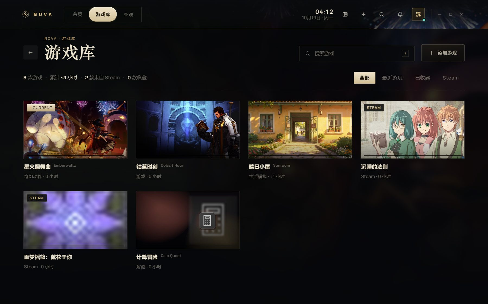
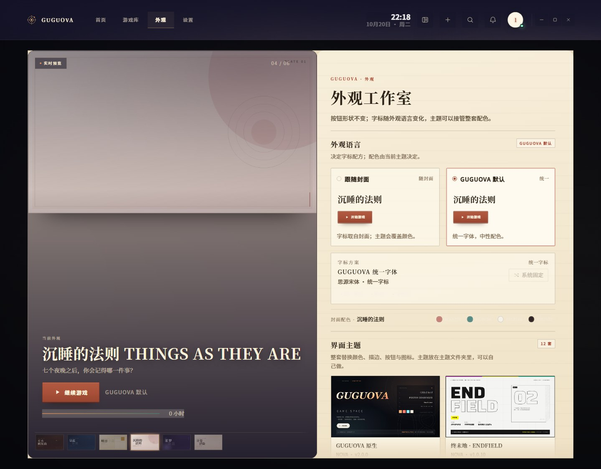

**设置**：玩家名、关闭行为、启动后最小化、全屏缩放方式、Steam 权限、自动备份、数据包、CSV、统计、兼容档位，都在这。

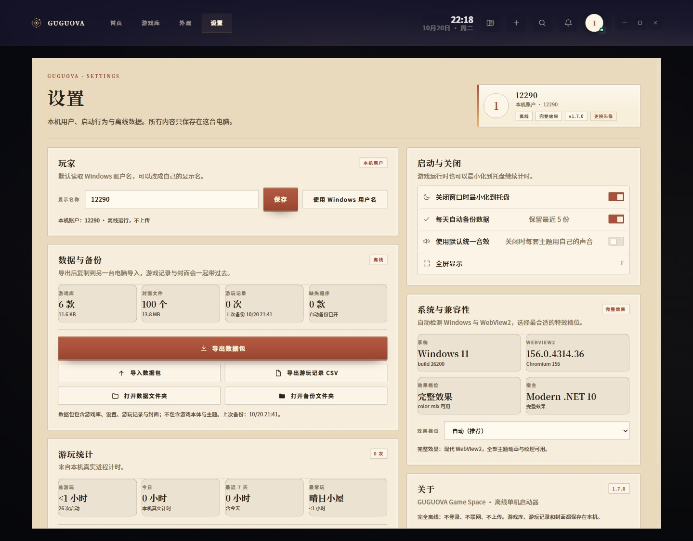
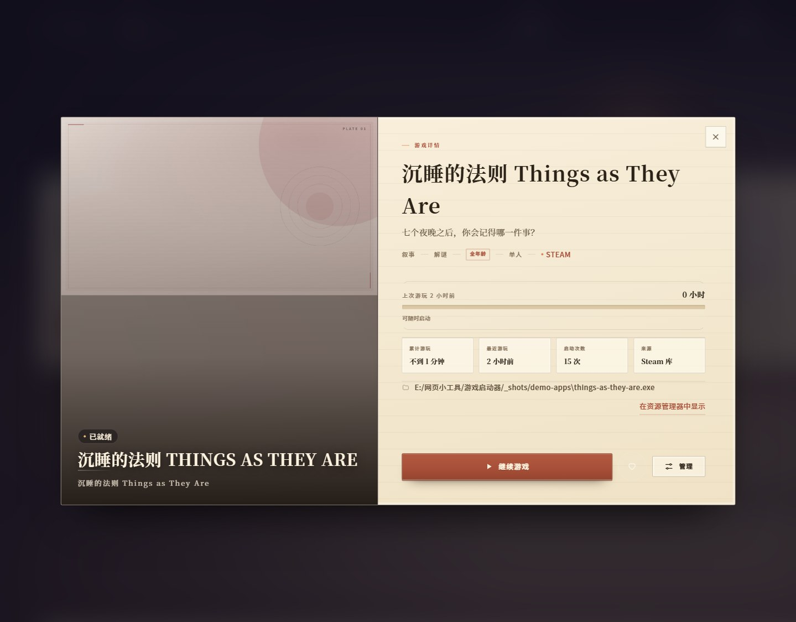

---

## 十四套界面主题

主题不是换一层颜色。每套主题有自己的版式、按钮形状、开场动画、进游戏动画和切换动画，
音效也各是一套（16 个）。在「外观 → 界面主题」里切，切换过程本身就是一段动画。

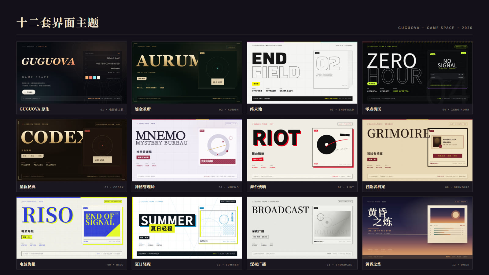

| 主题 | 一句话 |
|---|---|
| **GUGUOVA 原生** | 默认外观。全屏封面 + 暖色，按钮颜色跟着封面走。 |
| **鎏金圣所 AURUM** | 墨绿铁底、双层金线、羊皮铭牌、青玉能量点，开场是一道金门。 |
| **终末地 ENDFIELD** | 纸白底、墨线、唯一的酸黄色，像一本现场工程手册。 |
| **零点街区 ZERO HOUR** | 黑街漫画 + CRT 命令台，青柠是「当前」，青蓝是「信号」。 |
| **星轨秘典 CODEX** | 深褐铜版纸、金线、罗盘，像在档案馆读一页星图。 |
| **神秘管理局 MNEMO** | 雾紫档案、文件夹切口、CLASSIFIED 印章、等高线地图。 |
| **舞台残响 RIOT** | 纸面拼贴、黑胶、朱红硬影，像一张演出通行证。 |
| **冒险者档案 GRIMOIRE** | 羊皮纸角色卡、酒红缎带、双线金框、火漆印章。 |
| **电波海报 RISO** | 蓝黄双色印刷、套印错位、网点，像一张地下演出海报。 |
| **夏日轻程 SUMMER** | 白纸、青色制图线、黑块白字，杂志式的排版页。 |
| **深夜广播 BROADCAST** | 灰阶旧报纸、黑胶、波形，深夜电台的味道。 |
| **黄昏之炼 DUSK** | 暮色工房里的委托信：撕边纸、图钉麻绳、贴照、已受理章、火漆印、炼金环。 |
| **Steam 经典 STEAM CLASSIC** | Steam 大屏幕：全幅封面、炭黑控制台、底部最近游戏架、绿色继续、手柄键位条。 |
| **夜航 NIGHT FLIGHT** | 夜间航班登机牌：舷窗、虚线撕口、条码、DEPARTURES 离港航班表。 |

### 黄昏之炼

暮色天幕（靛蓝 → 紫 → 玫瑰 → 琥珀）压在远山后面，工房板上钉着一张委托信：
撕开的纸边、黄铜图钉、斜拉的麻绳、折痕、贴在纸上的委托人照片、红色的「已受理」章，
右下角压着封口的火漆印，左下角是委托人署名。纸面上还有一圈炼金环水印。
开屏是「暮色开工」：天空压下、太阳升起、远山浮出、炼金环描线、纸页展开、火漆印落下。
进游戏是炼金环从画面中心张开；切换主题时，一张信封合上、三角封盖折起再拆开。

设计规范见 [themes/dusk/DESIGN.md](themes/dusk/DESIGN.md)。

开屏和睡眠模式：

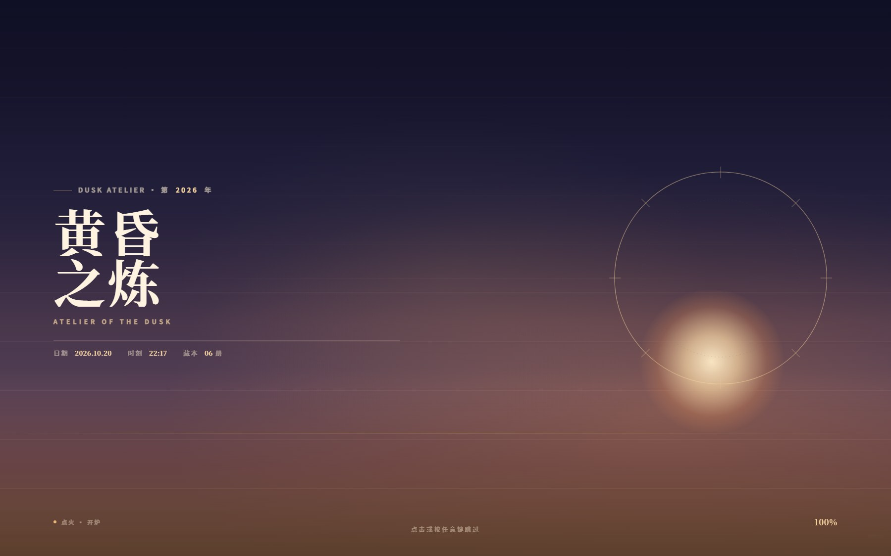
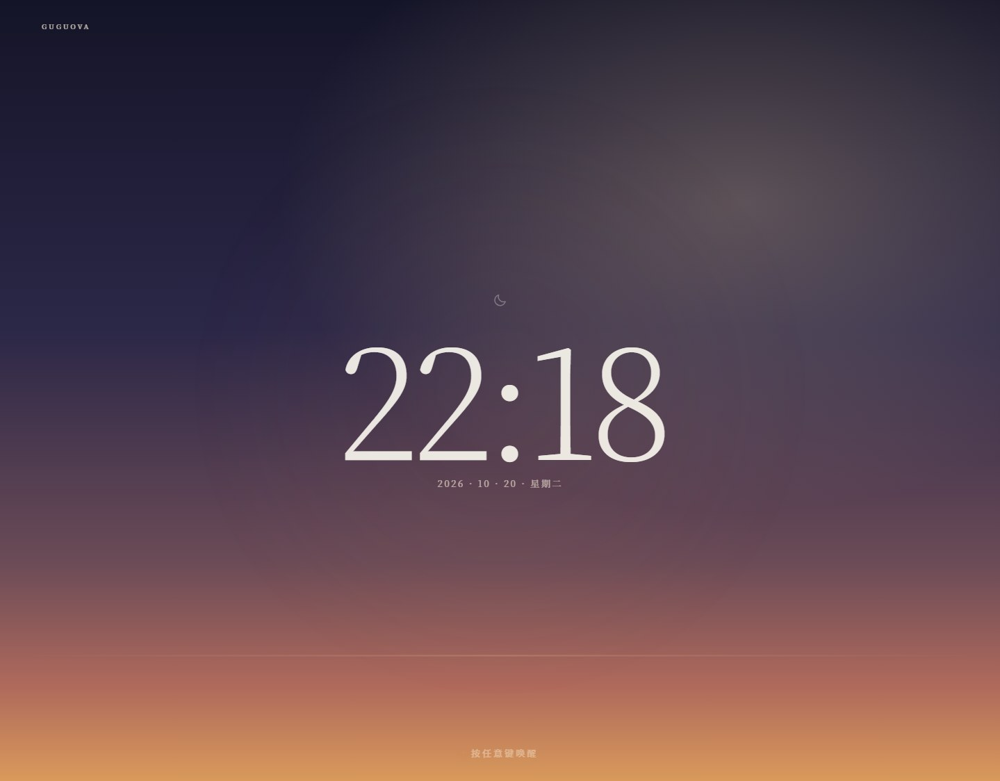

### Steam 经典

客厅里的大屏主机客户端：全幅游戏封面铺满舞台，左侧压暗放标题、绿色「继续游戏」与游玩时长，
底部是横向的「最近游戏」陈列架，最下方是手柄键位条与「离线模式」。
没有窗口卡片、没有右栏重复信息；白色焦点环与蓝色外晕负责「当前」。
开屏是大屏启动：字标升起、蓝色进度充满、四张封面滑入、焦点环落定。
切换主题时，一张游戏 tile 从中心放大到全屏，再揭开新的界面。

设计规范见 [themes/steam/DESIGN.md](themes/steam/DESIGN.md)。

### 夜航

一张夜间航班的登机牌：左缘荧光色带、右侧舷窗、虚线撕口、上下票根缺口、右下条码；
底部是 DEPARTURES 离港航班表，游戏库是与其他主题一致的 16:9 卡片网格（卡片做成登机牌票根）。
开屏是离港：星图亮起、跑道中线加速、`NIGHT / FLIGHT` 分瓣字逐字翻下、航班行打印真实数据。
切换主题时，上下两张票根沿虚线撕开，荧光扫描线扫过。

三套主题的 16 个音效都用 [genny](https://github.com/ogomez92/genny) 按主题材质重新合成：
黄昏是陶土、木、纸、玻璃与低弦；Steam 是电磁阀、控制台与低频合成；夜航是翻牌、机场铃、风与 PA 人声。

设计规范见 [themes/nightflight/DESIGN.md](themes/nightflight/DESIGN.md)。

其它主题的样子：

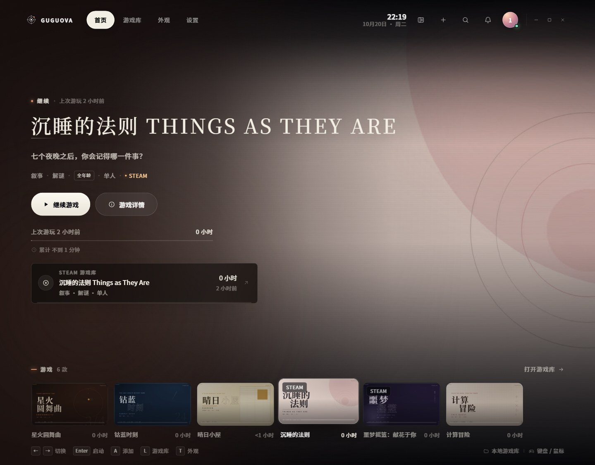
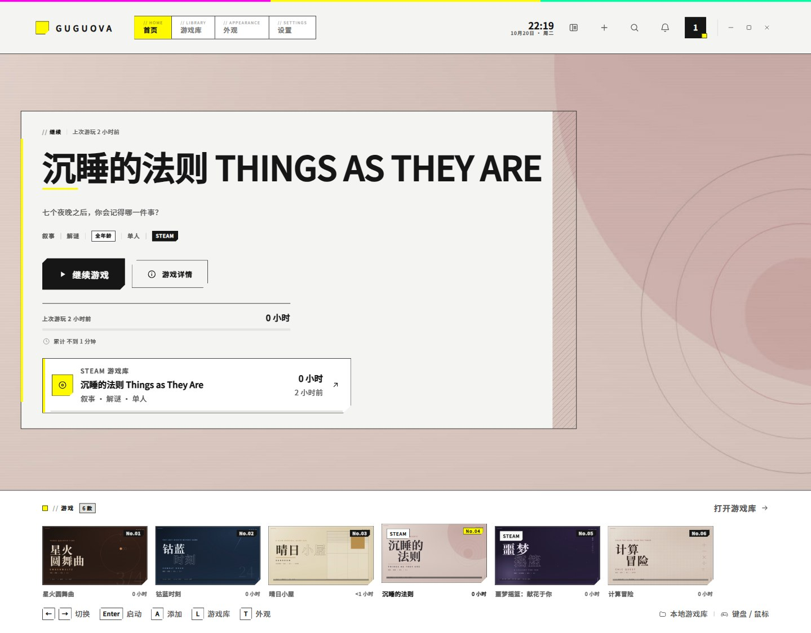
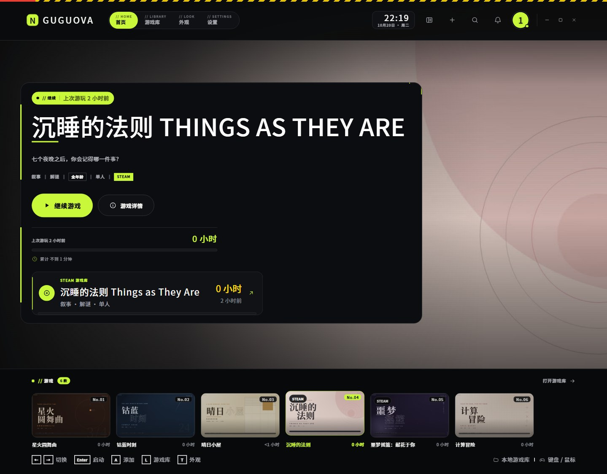
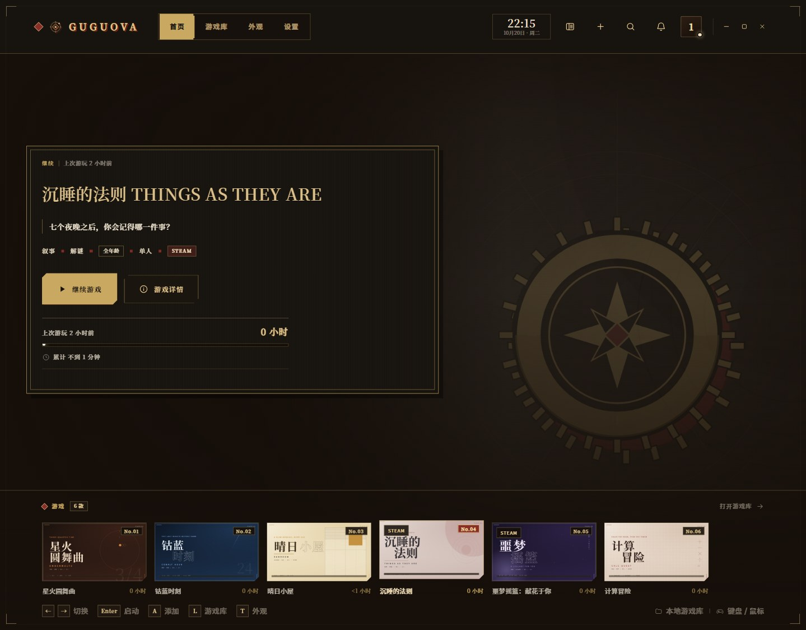
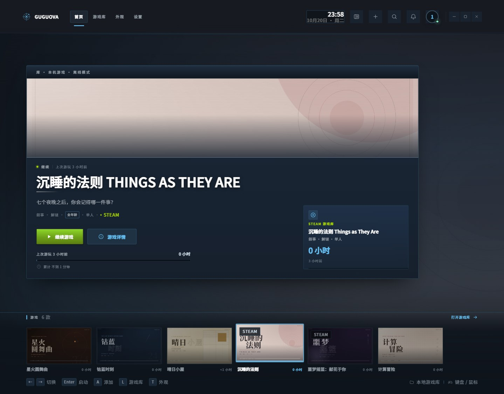
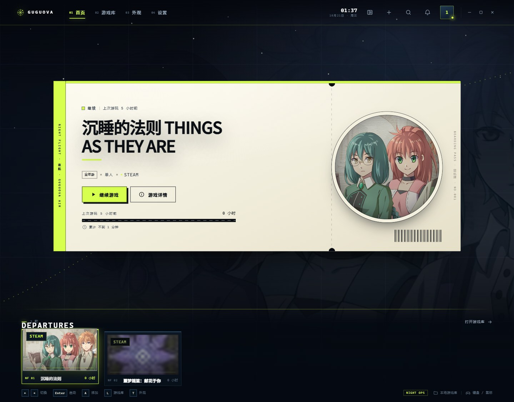

---

## 键盘与手柄

| 键 | 动作 |
|---|---|
| `←` `→` / `A` `D` | 切换游戏 |
| `Enter` | 启动当前游戏 |
| `I` | 游戏详情 |
| `L` | 游戏库 |
| `T` | 外观工作室 |
| `A` | 添加游戏 |
| `N` | 通知 |
| `M` | 界面音效开关 |
| `F` | 全屏 |
| `Esc` | 关掉当前层；再按退出全屏 |
| 右键 | 打开菜单 |
| `/` | 搜索 |
| `R` | 外观里重新编排字标 |

手柄：`A / ✕` 确认，`B / ○` 返回，`X / □` 收藏，`Y / △` 详情，`LB/RB` 翻页，
`Menu` 游戏库，`View` 通知，`L3` 外观，`R3` 设置。方向键和左摇杆按阅读顺序移动焦点。

---

## 数据和备份

全部在本机：

```
%LOCALAPPDATA%\NOVA Game Space\
├─ library.json     游戏库、设置、游玩记录
├─ media\           每款游戏的 hero.jpg / cover.jpg
├─ backups\         每天的自动备份（保留 5 份）
├─ themes\          你安装的主题
└─ nova.log         出问题时看这里
```

目录名还是 `NOVA Game Space`。这是程序内部的老标识，改它会让旧数据读不到，所以留着。

- **换电脑**：设置 → 数据与备份 → 导出数据包，把 `.nova-pack` 拷过去导入。
- **只备份数据**：直接复制 `library.json` 和 `media\`。
- **删游戏**：只删库里的记录和缓存封面，不动游戏目录、存档和 Steam 文件。

---

## 常见问题

**打开是黑屏 / 一闪就退**
先看 `nova.log`。多数是 WebView2 运行时缺失或损坏，装一遍微软的 WebView2 Runtime 再试。

**Steam 游戏点了没反应**
这类游戏要走 Steam 客户端。游戏详情 → 管理 → 启动方式，切成「Steam」；确认 Steam 已经登录。

**每次启动 Steam 游戏都要弹 UAC**
`Steam.exe` 被设成了「以管理员身份运行」。启动 Steam 游戏时按提示点「修复并重启 Steam」，
或者到 设置 → 系统与兼容性 → Steam 权限 点「修复提权弹窗」。
修复会移除该兼容性标记并重启一次 Steam（可能需要重新登录），之后就不会再弹。
原始标记会备份在数据目录的 `backups\steam-privilege-*.json`。

**全屏缩放没生效**
先看 设置 → 启动与关闭 里的引擎状态。`auto` 会优先用 Magpie；如果引擎没启动或
Windows 7 上不支持，会退回无边框。内置引擎是轻量版，Anime4K / CRT / CuNNy 等
大型算法需要指定本机完整 Magpie 或在构建时拉取完整效果。启动游戏后看 `nova.log` 的
`present ... engine=magpie|native` 就知道用了哪条路。引擎设置里缺效果文件的算法会置灰。

**快捷键没反应**
`auto` 模式下快捷键由 Magpie 持有；如果 Magpie 正在运行，换键后启动器会重启它。
`native` 模式下由启动器自己注册；若提示「注册失败」，通常是别的程序占用了同一组合键，
换一个组合键即可。

**游戏窗口被启动器挡住 / 没自动切过去**
设置 → 启动与关闭，确认「启动游戏后最小化」是开的。游戏窗口出现后启动器会自动收起，
游戏退出后再回来。如果游戏本身要几十秒才建窗口，启动器最多等 15 秒。

**计时不对**
计时跟着被启动的那个进程。有些游戏先起一个启动器再拉本体，记到的是启动器的时间。

**封面不是我想要的**
详情 → 管理 → 编辑游戏信息与封面，可以换图，也可以拖动、缩放取景，每款游戏单独保存。
Steam 游戏如果封面糊，点「用 Steam 最新封面重新导入」；它读的是客户端缓存里的原图，
需要先在 Steam 里打开过一次这款游戏的库页面。

**主题能自己做吗**
可以。主题就是 `themes\` 里的一个文件夹：`theme.json` + `theme.css` + `preview.jpg`，
不能执行脚本，所以别人的主题也能放心装。规范见 [docs/THEMES.md](docs/THEMES.md)。

**它会联网吗**
不会。Steam 相关的操作只调用本机客户端、只读本机清单和缓存。

---

## 从源码构建

需要 .NET 10 SDK。

```bash
dotnet run
bash tools/release.sh --version 1.15.0     # 构建 + 校验 + 单 exe 冒烟
```

产物在 `dist\`，附带 `release-manifest.json`（SHA-256 和体积）。
开发细节在 [docs/HANDOFF-NEXT.md](docs/HANDOFF-NEXT.md)，
启动链路见 [docs/GAME-DISPLAY.md](docs/GAME-DISPLAY.md) 与 [docs/STEAM-LAUNCH.md](docs/STEAM-LAUNCH.md)。

---

## 许可

程序与界面代码归本项目所有。第三方素材：

- 字体：思源黑体 / 思源宋体（SIL OFL）。程序不自带西文字体，缺字体时回落到系统字体。
- 音效：全部为本地合成，生成脚本在 `tools/sfx-specs/`。
- 示例封面：`tools/demo-covers.py` 生成，纯排版与几何，不含任何游戏素材。
