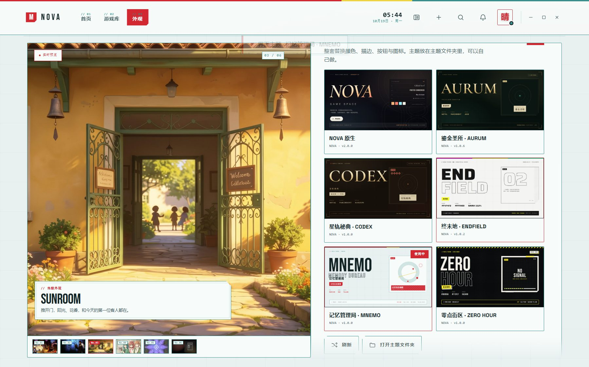

# NOVA 主题开发规范

> 版本 1.2 · 对应 NOVA Game Space 1.2.2
> 每个主题交付前必须过一遍 **[THEME-COVERAGE.md](THEME-COVERAGE.md)**。
> 一个主题可以整套换掉界面的颜色、描边、按钮、图标与纹理，**不会**影响布局逻辑、启动流程或数据。

---

## 1. 主题是什么

主题就是一个文件夹：

```
my-theme/
├─ theme.json       必填，描述这个主题
├─ theme.css        必填（或由 theme.json 的 css 字段指定）
├─ preview.jpg      可选，主题卡片上的预览图，建议 960×540
└─ assets/          可选，你自己的纹理、图标
```

把文件夹放进：

```
%LOCALAPPDATA%\NOVA Game Space\themes\
```

然后在「外观 → 界面主题」点「刷新」，就能看到并选择它。

也可以打包成 `.zip` 分发，解压后只要 `theme.json` 在压缩包的第一层或第二层目录里即可。

> 程序自带的主题（`aurum`）也会出现在这个目录里，可以复制一份改成自己的。

---

## 2. theme.json

```json
{
  "schema": 1,
  "id": "my-theme",
  "name": "我的主题",
  "author": "你的名字",
  "version": "1.0.0",
  "description": "一句话说明这个主题长什么样。",
  "css": "theme.css",
  "preview": "preview.jpg",
  "base": "adaptive",
  "intro": "endfield",
  "tokens": {
    "--accent": "#e0bd7e",
    "--accent-2": "#5fd6c6"
  },
  "icons": {
    "play": "<path d=\"M8 5l11 7-11 7Z\" fill=\"currentColor\" stroke=\"none\"/>"
  }
}
```

| 字段 | 必填 | 说明 |
|---|---|---|
| `schema` | 是 | 固定 `1`。 |
| `id` | 建议 | 小写字母、数字、连字符，≤40 字符。留空时用文件夹名。不能用 `nova`。 |
| `name` | 是 | 显示在主题卡片上的名字。 |
| `author` | 否 | 作者。 |
| `version` | 否 | 版本号，建议语义化。程序升级自带主题时会比较它。 |
| `description` | 否 | 卡片提示文字。 |
| `css` | 否 | 主样式表，默认 `theme.css`。 |
| `preview` | 否 | 预览图，默认依次找 `preview.jpg`、`preview.png`。必须是**设计概念板**，不要用应用截图；见第 13 节。 |
| `base` | 否 | `adaptive` / `system`，选择默认走「跟随封面」还是「NOVA 默认」。 |
| `intro` | 否 | 开场动画预设 id，见第 10 节。留空使用内置 `gilded`。 |
| `tokens` | 否 | 直接覆盖 CSS 变量，适合只换配色的轻量主题。 |
| `icons` | 否 | 覆盖内置图标，见第 5 节。 |

### 校验规则

程序会拒绝以下主题，并在卡片上显示原因：

- `schema` 不是 `1`
- 缺少 `name`
- `id` 含非法字符，或与内置 `nova` 重名
- `id` 与已安装主题重复（先装的生效）
- `theme.json` 不是合法 JSON

CSS 文件缺失不会导致失败，只是没有样式覆盖。

---

## 3. 样式怎么写

主题 CSS 最后加载，因此可以直接覆盖基础样式。**不要改布局**，只改外观。

### 3.1 最省事的做法：只给变量

```json
"tokens": {
  "--accent": "#7ee0c0",
  "--accent-2": "#2f8f74",
  "--glow": "rgba(126, 224, 192, .28)"
}
```

这样按钮高光、进度条、开关、焦点环会一起变。适合做「换色包」。

### 3.2 完整主题：写一份 CSS

参考 `themes/aurum/theme.css`，它覆盖了：

- 页面底色、氛围层、噪点与斜纹
- 顶栏、导航、窗口按钮
- 主按钮、次按钮、危险按钮
- 进度条（含分段刻度）
- 活动条、游戏条、封面卡片
- 弹层、菜单、通知、对话框
- 输入框、开关、文件浏览器
- 启动画面、睡眠画面、Toast、手柄提示

### 3.3 必须遵守的几条

1. **不要改尺寸和位置**。可以改 `border-radius`、`border`、`background`、`color`、`box-shadow`、`clip-path`、`font-family`，不要改 `display`、`position`、`width/height`（除非是装饰元素）、`padding` 的大幅变化。
2. **保证对比度**。正文文字与背景至少 4.5:1，按钮文字至少 4.5:1。
3. **深色或浅色都要能读**。如果做浅色主题，记得同时改 `--ink`、`--muted`、`--faint`。
4. **不要用 `!important` 去改按钮的文字颜色以外的东西**。主按钮的渐变由 `--cta-bg` 控制，见 3.4。
5. **不要引用外部网络资源**。所有图片放到主题目录的 `assets/` 里，用相对路径引用。
6. **主题选中时，封面配色只影响背景遮罩**。`--accent`、`--accent-2`、`--glow` 不再由封面覆盖，
   而是使用主题的 `tokens` 或 CSS。标题也建议统一成主题自己的颜色，避免封面把蓝色/粉色带进 UI。
7. **开场动画只写预设 id**，不要把动画逻辑写进 CSS 主题；见第 10 节。
8. **不能让文字或按钮被截断/重叠**。主题可以改字号、字距，但不能让标题溢出主视觉、
   让按钮文案被裁掉或让徽章压住别的文字；长标题依赖 `fitLogo` 缩放，
   长标签应允许换行。这是项目铁律，验收时必须检查窄屏与全屏。
9. **切角只给可按的东西**。按钮、卡片、筛选块、编号标签可以切角；正文容器、弹层、
   预览画框保持直角。切角里不压字，内边距至少留出一个切角的宽度。
10. **不要用柔和渐变、发光或玻璃模糊**。封面满幅 `cover`，文字放进实色铭牌；
    需要阴影时用硬边偏移或 45° 斜线纹，不用 `box-shadow: 0 20px 40px` 这类软阴影。
    进度、状态、当前项用实色填充，不用光晕。
11. **主题预览图也属于主题设计**：它必须是统一模板的概念板，不是应用截图。
    新主题交付时必须附带一张 960×540 的 `preview.jpg`，具体版式见第 13 节。
12. **右键菜单、`select`、构图控件也要覆盖**。`.context-menu` / `.context-item` 与
    `.popover` / `.menu-row` 是两套类；`.field select` 在浅色主题里必须显式写
    `option` 与箭头；`.editor-framing` 是 1.2.2 新增。完整清单见 `THEME-COVERAGE.md`。

### 3.4 主按钮

主按钮的颜色由一组变量控制，主题里重新声明即可：

```css
body .btn.primary.cta-adaptive,
body .btn.primary.cta-system {
  --cta-bg: linear-gradient(180deg, #d9b878, #8a6130);
  --cta-bg-hover: linear-gradient(180deg, #ecd093, #9a6d36);
  --cta-fg: #16110a;
  --cta-border: rgba(255, 238, 200, .62);
  background: linear-gradient(180deg, #d9b878, #8a6130);
  color: #16110a;
}
```

> 为什么要写在 `body` 下：基础样式在 `.btn.primary` 上声明了同名变量，
> 用 `body` 前缀可以稳定覆盖，避免和「跟随封面」的内联变量打架。
>
> 内置默认主题的已知游戏使用 `src/cta-palettes.css` 里的手调 palette class
> （`cta-emberwaltz`、`cta-cobalt-hour` 等）；未知游戏用封面采样。
> 主题激活时 palette class 会被移除，主题自己的 `--cta-*` 优先。

---

## 4. 可用的 CSS 变量

基础样式已经定义了这些，主题可以直接改：

| 变量 | 用途 |
|---|---|
| `--ink` | 主文字色 |
| `--muted` | 次级文字 |
| `--faint` | 三级文字 |
| `--hair` | 分隔线 |
| `--accent` | 主强调色（进度、开关、选中） |
| `--accent-2` | 次强调色（渐变终点） |
| `--glow` | 光晕 |
| `--ease` | 缓动曲线 |
| `--font-ui` | 正文字体 |
| `--font-display` | 数字与展示字体 |
| `--font-serif` | 衬线字体 |

按钮相关的：`--cta-bg`、`--cta-bg-hover`、`--cta-fg`、`--cta-border`、`--cta-shadow`、`--cta-h`。

标题相关的：`--logo-accent`、`--logo-accent-2`、`--logo-light`、`--logo-dark`。

---

## 5. 换图标

`icons` 里写 SVG 片段，会替换内置图标。键名对应图标 id（去掉 `i-` 前缀）：

```
play, info, search, bell, heart, sliders, fullscreen, moon,
sound-on, sound-off, plus, folder, disc, clock, gamepad,
download, check, close, arrow-right, arrow-left, spark
```

例如把一个播放三角换成圆形播放键：

```json
"icons": {
  "play": "<circle cx=\"12\" cy=\"12\" r=\"8.5\" fill=\"none\" stroke=\"currentColor\" stroke-width=\"1.6\"/><path d=\"M10 8.6v6.8l5.4-3.4Z\" fill=\"currentColor\" stroke=\"none\"/>"
}
```

写的是 `24×24` 视口内的 SVG 内容，`currentColor` 会跟随文字颜色。

> 图标会覆盖所有使用该图标的地方（主按钮、卡片、菜单等），所以保持风格统一。

---

## 6. 纹理与图片

放在主题目录里，CSS 用相对路径：

```css
body::before {
  background-image: url("assets/metal.png");
  background-size: 256px 256px;
}
```

路径相对于 `theme.css` 所在位置。渲染层在把主题 CSS 内联进页面前，
会把所有相对 `url(...)` 重写成 `https://nova.themes/<主题目录>/...`；
`data:`、`http(s):`、`//` 与 `#` 开头的地址保持原样。不能引用主题目录之外的文件。

---

## 7. 调试

1. 改完 CSS 后不需要重启，在「界面主题」里点其他主题再点回来，或者点「刷新」。
2. 程序读取主题时会绕过文件缓存，保存即生效。
3. 主题报错会显示在卡片上。常见原因：JSON 逗号写多了、`id` 用了大写、`css` 路径写错。
4. 想要详细的加载日志，看 `%LOCALAPPDATA%\NOVA Game Space\nova.log`。

---

## 8. 安全边界

主题只能改样式和图标，**不能**：

- 执行脚本
- 读取游戏库、文件路径或任何用户数据
- 调用系统接口
- 访问主题目录以外的文件
- 改动启动逻辑、计时或数据存储

所以可以放心安装别人做的主题，也可以放心把自己做的发给别人。

---

## 9. 打包分发

```bash
# 目录结构
my-theme/
  theme.json
  theme.css
  preview.jpg
  assets/...

# 打包
zip -r my-theme.zip my-theme/
```

用户把 zip 解压到 `themes` 目录，或者在「打开主题文件夹」后放进去，点「刷新」即可。

建议在 `theme.json` 里写清楚 `author` 和 `version`，方便别人辨认和更新。

---

## 10. 开场动画

开场是一套**独立于主题的预设注册表**，实现在 `src/intro.js` 与 `src/intro.css`。
主题只在 `theme.json` 里写预设 id：

```json
"intro": "aurum"
```

内置预设：

| id | 气质 | 默认 |
|---|---|---|
| `gilded` | 鎏金罗盘、金色描线 | 内置主题 |
| `aurum` | 墨绿底 + 鎏金 + 青玉；AURUM 主题使用 | |
| `endfield` | 深色启动控制台：三色条、实心/空心字标、真实读数、乱码落定、分段进度、快门退场；ENDFIELD 主题使用 | |
| `codex` | 星轨秘典：深褐底 + 双层金线 + 虚线内框 + 红玉菱形 + 星盘时钟 + 菱形收束；CODEX 主题使用 | |
| `zerohour` | 零点街区：CRT 信号接入、黑白 + 警示黄、扫描线、贴纸字标、信号进度与折叠退场；ZERO HOUR 主题使用 | |
| `mnemo` | 记忆管理局：冰蓝记忆地图、红色节点、黄色路径、红色错误牌复位、横向折叠退场；MNEMO 主题使用 | |
| `ink` | 浅色纸面 + 墨线（保留给浅色主题） | |
| `ember` | 暖橙余烬 | |
| `veil` | 最短的薄幕，只用文字 | |

**新增一个预设**（不改启动流程）：

1. 在 `src/intro.js` 里 `register('my-intro', { label, duration, setup? })`；
2. 在 `src/intro.css` 里加一段 `.intro[data-intro="my-intro"] { --intro-… }` 变量；
   需要结构性差异时，用 `setup(overlay)` 加一个 class，再写对应 CSS；
3. 主题里写 `"intro": "my-intro"`。

开场会自动遵守 `prefers-reduced-motion` 与「减少动效」：直接淡入，不播放位移。
任何按键、鼠标点击、手柄按键都可以跳过。

---

## 11. 参考主题：AURUM

`themes/aurum/` 是一套完整示例，学它最快：

- 墨绿铁底 + 细噪点与斜纹
- 双层鎏金描边 + 四角金属括号
- 羊皮纸铭牌按钮 / 导航 / 筛选
- 青玉能量进度条（`repeating-linear-gradient` 做刻度）
- 铆钉装饰（`radial-gradient` 画圆点）
- 卡片四角括号（伪元素 + 边框）
- `"intro": "aurum"` 的独立开场预设

它证明了：**只用 CSS + 一个预设 id，就能把一个界面变成完全不同的气质**，而且不需要改任何一行结构代码。

---

## 12. 参考主题：ENDFIELD

`themes/endfield/` 是第二轮新增的完整示例，展示「工业纸面 + 唯一酸黄信号」的做法：

- **变体卡**：酸黄 `#FFFA00` / 中性纸 `#F4F4F2` / 标准切角 / 细线网格 / 标准密度 / 完整动效。
  主界面是纸面控制台；启动与睡眠换成深色命令面（同一主题的两种页面类型，不是反色）。
- **字形**：自带 Saira 可变字体（`assets/Saira.ttf`，SIL OFL 1.1，许可文件同目录），
  `font-stretch` 拉到 112% / 125%；中文回退到系统黑体。标题统一 800 字重、墨色。
- **形状**：主按钮、次要按钮、筛选块、游戏卡片、开关、菜单项切角；弹层、画框、纸面铭牌保持直角。
  切角内留出足够内边距，长标题走 `fitLogo`。
- **封面**：满幅 `cover`，不再用模糊铺底或暗角渐变；信息放进实色墨色铭牌
  （外观预览、详情页），底部游戏切换改成纸面编号条（`No.01`…）。
- **不使用**：柔和渐变、发光、玻璃模糊、软投影；需要质感时只用 45° 斜线纹、1px 细线、
  实色三色条与真实编号。
- **开场**：`"intro": "endfield"`，深色启动序列；真实日期、年份、游戏数与分段进度；
  任意键 / 鼠标 / 手柄跳过；减少动效时直接显示最终状态。
- **可复现**：所有图形与纹理都是 CSS 绘制或本项目生成的图片，没有使用游戏官方素材。


---

## 13. 主题预览图：统一概念板

主题卡片上的预览图**不是应用截图**，而是一张按统一模板设计的概念板。
默认主题、AURUM、ENDFIELD 三张预览共用同一套构图，只换主题自己的颜色、字体、材质与图形语言。
以后新增自带主题也按这套做；第三方主题强烈建议照做。

### 13.1 版式（960×540）

```
┌──────────────────────────────────────────────────────────────┐
│ // NOVA THEME · NAME                       2026.10.19 │ NOTE │
│                                                              │
│  ███ 大字标（实心 / 衬线 / 宽体）        ┌────────────────┐  │
│  ███ 第二行（空心 / 副标题）             │ No.01          │  │
│  ▇ 中文名 / 材质标记 ▇                   │  主题自己的     │  │
│  FIELD      FIELD      FIELD              │  图形 / 材质样张 │  │
│                                           └────────────────┘  │
│ // COMMAND STRIP                  MATERIAL · TYPE · RULE      │
└──────────────────────────────────────────────────────────────┘
```

- **画布**：960×540（2× 渲染后缩小也可以）。卡片实际显示约 264×148，所有元素要在这个尺寸仍可读。
- **顶部**：左侧 `// NOVA THEME · <NAME>` 眉标，右侧一个真实字段（日期、版本或系列名）。
- **左栏（约 55–60%）**：主题的超级字标 + 第二行（空心或副标题）+ 一个实色中文名/材质标记 + 3 个字段。
- **右栏（约 35–40%）**：一个主题语言的“样张框”：切角画框、徽章、材质铭牌、字标样张或编号圆盘；
  里面只放主题自己的图形语言，**不要放应用界面**。`No.01` 之类的编号必须是真实的（主题序号 / 方案数）。
- **底部**：贯穿全宽的 command strip，写材质、色值、字体、切角或规则等 token。
- **统一的是骨架**：眉标、左字标、右样张、底部条的位置固定；颜色、字体、纹理、图形由主题决定。
- **禁止**：应用截图、游戏官方素材、模板占位（ACME / 示例）、编造的编号或数据。

三张预览在主题卡片里的实际效果：



### 13.2 六张参考

| 主题 | 左栏 | 右栏 | 底部条 |
|---|---|---|---|
| NOVA 原生 | Cormorant 斜体鎏金字标 + `GAME SPACE` | 8 套字标配方 + 封面采样色板 | `ADAPTIVE BUTTON · 08 TYPE RECIPES · 16:9 HERO` |
| AURUM | Cormorant 金色 `AURUM` + 鎏金圣所铭牌 | 墨绿样张框 + 罗盘环 + 羊皮纸铭牌 | `DOUBLE GOLD · PARCHMENT · JADE` |
| ENDFIELD | Saira 800 实心 `END` + 空心 `FIELD` | 切角画框 + 空心 `02` + 斜线纹 | `PAPER / INK / SIGNAL · 9PX CUT · 1PX RULE` |
| CODEX | Cormorant `CODEX` + 星轨秘典 | 墨绿/金样张框 + 罗盘环 + 红玉菱形刻度 | `DOUBLE GOLD · MAROON DIAMOND · SERIF` |
| ZERO HOUR | Bebas `ZERO` 实心 + `HOUR` 空心 + 零点街区贴纸 | 白纸 CRT 框 + 半调 + 警示黄阴影 | `CRT · HALFTONE · HAZARD YELLOW` |
| MNEMO | Bebas `MNEMO` 实心 + 空心 `MEMORY BUREAU` + 记忆管理局红牌 | 冰蓝记忆地图 + 青色环 + 红色节点 + 黄色路径 | `ICE HUD · TEAL LINE · RED NODE · YELLOW ROUTE` |

### 13.3 生成方式（可复现）

1. 在 `tools/theme-concepts.html` 里增加一块 `<section class="board <id>">`，复用现有五块的结构与尺寸。
2. 启动应用（需要 CDP）：`NOVA_CDP_PORT=9223 ./NovaGameSpace.exe`。
3. 把概念页复制到运行目录的 `src/`（或发布目录的 `src/`），运行：
   `NOVA_CDP_PORT=9223 node tools/render-concepts.js _shots`
4. 用图片工具把 1920×1080 的输出缩到 960×540，保存为主题目录的 `assets/preview.jpg`。
5. 在 `theme.json` 里 bump `version`，让用户目录里的旧预览刷新。

> 内置 NOVA 没有主题目录，它的概念板放在 `src/assets/theme-nova-preview.jpg`，
> 通过 `theme-engine.js` 的 `BUILT_IN.previewUrl` 提供给主题卡片。


---

## 14. 参考主题：CODEX / ZERO HOUR / MNEMO

三套 1.2.2 新增的完整主题，分别演示「暗色秘典」「街区漫画」「冰蓝记忆档案」三种语言。

### 14.1 星轨秘典 · CODEX（`themes/codex/`）

- **变体**：深褐纸面 / 双层金线 / 虚线内框 / 红玉菱形 / 星盘时钟 / 衬线标题。
- **主界面**：深褐底 + 金色网格；主视觉是深色 dossier 铭牌，金色 Cormorant 标题，
  羊皮纸主按钮，红玉菱形代替 meta 分隔点；dock 与库卡片使用双金线与编号。
- **组件**：右侧参考样张是罗盘环 + 菱形刻度 + 羊皮纸铭牌；右键菜单、编辑器 `select`、
  构图控件、启动页、详情/外观预览全部覆盖。
- **开场**：`"intro": "codex"` —— 金色星盘、旋转指针、红玉菱形、菱形收束；
  无数字，保持安静的仪式感。
- **预览**：`assets/preview.jpg`，统一概念板（NO.03）。

### 14.2 零点街区 · ZERO HOUR（`themes/zerohour/`）

- **变体**：黑 / 纸白 / 警示黄 / 半调网点 / 粗黑边 / 硬偏移阴影 / 胶带贴纸 / CRT。
- **主界面**：**黑色 command 面板**压在封面左侧，白色 2px 描边、白色 Bebas 标题、
  黄色标题硬阴影；眉标 lime 贴纸，主按钮黄色药丸 + 黑色硬阴影；dock 是黑底白框，
  选中卡片 lime 描边并带编号贴纸。活动条是实色深面板，白字，不再半透明/灰化。
- **组件**：右键菜单是黑底白框 + 黄色阴影；库/外观是黑底白卡 + 半调；
  详情/外观预览使用纸白铭牌；启动页是 CRT 扫描线 + 信号环；睡眠是待机屏。
- **开场**：`"intro": "zerohour"` —— CRT 通电、危险条、频道读数、ZERO/HOUR 贴纸、
  真实日期和游戏数、信号进度，最后折叠成一条线。
- **预览**：`assets/preview.jpg`，统一概念板（NO.04）。
- **1.2.2 参考修正**：按 `绝区0参考/` 与 `精选参考/` 的界面图，把主视觉从白色漫画面板
  改为**黑色 command 面板**（白色粗描边、白字、黄色硬阴影），补上 **lime 绿选中态**、
  圆角药丸按钮、圆形图标、12–20px 圆角面板、斜线扫描纹理与背景巨字 `ZERO HOUR`；
  黄色仍只做主操作/提醒，lime 只做当前/选中。活动条改为实色深面板 + 白字，
  修复灰底黑字看不清的问题。
- **参考与取舍**：机核 [185949](https://www.gcores.com/articles/185949) / [185722](https://www.gcores.com/articles/185722)、
  知乎 [707011925](https://zhuanlan.zhihu.com/p/707011925) / [3578527168](https://www.zhihu.com/question/661145347/answer/3578527168)
  都在批评 ZZZ 常规 UI 过重、纯黑纯白与高饱和、装饰字体滥用、按钮层级与状态不清。
  ZERO HOUR 只借它的高对比街区语言（黑白 + 警示黄 + 半调 + 贴纸），不借信息过载：
  底色用 off-black `#08090A`、纸色用 off-white `#F1EFE7`；Bebas 只做展示，正文用 Space Grotesk；
  主操作唯一（黄色），次操作白底，红色只留给删除；标签保持水平可读；按钮保留
  普通/焦点/悬停/按下/禁用状态；右键菜单把当前项和可操作项分开。

### 14.3 记忆管理局 · MNEMO（`themes/mnemo/`）

- **变体**：冰蓝纸面 / 冷白 HUD / 青色数据线 / 红色节点 / 黄色路径 / 块状字标 / 红色错误牌。
- **主界面**：浅冰蓝记忆地图底，主视觉是近不透明的冰白 HUD 铭牌，青色内框、红色角节点、
  黄色路线；标题 Bebas + 粗体中文；主按钮墨色，当前/节点用红色，路径/进度用黄色。
- **组件**：库/外观是冰蓝档案页，卡片细青线、当前红色；右键菜单冰白底 + 红色悬停；
  详情/外观预览是冰白铭牌；编辑器字段白底青线；启动/睡眠是深青扫描室。
- **开场**：`"intro": "mnemo"` —— 冰蓝记忆地图、红色节点、黄色路径、红色「记忆无法读取」
  错误牌，约 1.3s 后复位为「记忆已恢复 / ARCHIVE RESTORED」，最后横向折叠退场；
  日期、时间、游戏数、年份真实。
- **预览**：`assets/preview.jpg`，统一概念板（No.05）。
- **参考**：`记忆管理局UI参考/` 的冰蓝地图、红色节点、黄色路径、块状字标与红色 ERROR 屏
  只作为语言参考，没有复制任何素材；红色错误牌只出现在开场/错误态，不进入日常阅读界面。

### 14.4 交付检查

三套主题都必须通过 **[THEME-COVERAGE.md](THEME-COVERAGE.md)** 的第 1–10 节，
重点检查右键菜单、`select`、构图控件、启动/睡眠、详情/外观和 960px 布局。
